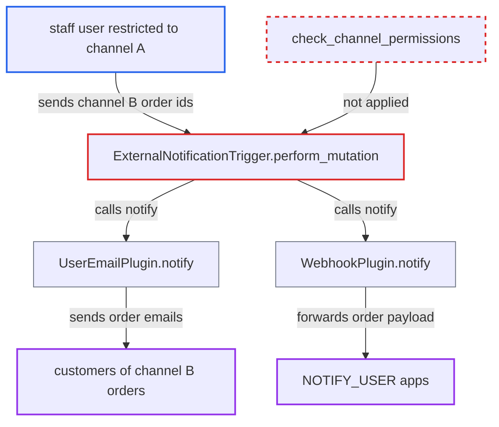

# externalNotificationTrigger skips channel authorization for Order IDs

| Field | Value |
|---|---|
| ID | `find_0151ugAN53wPohKFnCgyqAve` |
| Severity | **Low** |
| Status | open |
| CWE | CWE-863 — Incorrect authorization |
| Created | 2026-10-27T21:19:25.533224Z |
| Claude Security | https://claude.ai/security/findings/find_0151ugAN53wPohKFnCgyqAve |

## Description

A staff user restricted to one sales channel can make the shop send genuine-looking customer emails for orders in other channels. The same order data also goes to `NOTIFY_USER` apps. The attacker needs `MANAGE_ORDERS` and must already know the target order ids. `ExternalNotificationTrigger.perform_mutation` checks only that global permission and never calls `check_channel_permissions`.

1. **staff user** calls `externalNotificationTrigger` with other-channel order ids. The user has `MANAGE_ORDERS` in a group restricted to channel A. They pass the ids of channel-B orders, an active channel slug in `channel`, and an `externalEventType` such as `order_canceled`.
2. **the mutation `ExternalNotificationTrigger.perform_mutation`** checks only the global `MANAGE_ORDERS` permission and loads the orders. It loads them with `Order.objects.filter(pk__in=pks)` and never calls `check_channel_permissions`, so the user's channel restriction is not applied. ([`saleor/graphql/notifications/mutations/external_notification_trigger.py:69-91`](https://github.com/cx-benchmark/saleor/blob/c982006cc04c77a97def93218dedac8d715eb041/saleor/graphql/notifications/mutations/external_notification_trigger.py#L69-L91))
3. **the mapping in `PAYLOAD_MAPPING_FOR_CUSTOM_NOTIFICATION`** selects `get_custom_order_payload` for `Order` ids, guarded only by `MANAGE_ORDERS`. No channel scope is attached to this mapping. ([`saleor/core/notification/validation.py:12-23`](https://github.com/cx-benchmark/saleor/blob/c982006cc04c77a97def93218dedac8d715eb041/saleor/core/notification/validation.py#L12-L23))
4. **`get_custom_order_payload`** builds a payload for each order with the customer's email as `recipient_email`. The payload has the same shape as the real order-email payloads, plus `extra_payload`. ([`saleor/order/notifications.py:305-311`](https://github.com/cx-benchmark/saleor/blob/c982006cc04c77a97def93218dedac8d715eb041/saleor/order/notifications.py#L305-L311))
5. **`UserEmailPlugin.notify`** sends the customer email chosen by `externalEventType`. It dispatches any event in `UserNotifyEvent.CHOICES`, so the caller picks which customer-facing email goes out for the order. `WebhookPlugin.notify` also forwards the payload to `NOTIFY_USER` apps. ([`saleor/plugins/user_email/plugin.py:392-412`](https://github.com/cx-benchmark/saleor/blob/c982006cc04c77a97def93218dedac8d715eb041/saleor/plugins/user_email/plugin.py#L392-L412))

## Assessment

The attacker is a staff user with `MANAGE_ORDERS` in a permission group restricted to one channel through `restricted_access_to_channels`. They need the UUID global ids of orders in another channel. These could come from `GiftCardEvent.orderId` or from links customers share. `Order` ids are UUIDv4, so they cannot be enumerated. The `channel` argument only has to name an existing, active channel. An active notify consumer must be present: the User Email plugin or a `NOTIFY_USER` app. No victim action is needed.

Impact: The attacker can trigger emails such as `order_confirmation`, `order_canceled`, `order_payment_confirmation` or `order_refund_confirmation`. These go to customers of orders outside their channel scope, from the shop's own mail setup, so they can mislead or phish. The orders are also pushed to `NOTIFY_USER` apps. Nothing is returned to the attacker and no order state changes, so the effect is limited.

## Recommendation

`ExternalNotificationTrigger.perform_mutation` authorizes by global permission only. It never applies the per-object channel check that other order-acting mutations use, so channel-scoped staff restrictions are ignored.

Fix criteria: A requester with restricted channel access is refused with `PermissionDenied` when any referenced `Order` belongs to a channel outside their accessible channels. The refusal comes before any payload is built or `manager.notify` is called. A channel-restricted `MANAGE_ORDERS` staff token calling the mutation with an order from another channel triggers no email or webhook and gets an authorization error. The same call for an order in an accessible channel still succeeds.

## Evidence

**https://github.com/cx-benchmark/saleor**

- [`saleor/graphql/notifications/mutations/external_notification_trigger.py:69-91`](https://github.com/cx-benchmark/saleor/blob/c982006cc04c77a97def93218dedac8d715eb041/saleor/graphql/notifications/mutations/external_notification_trigger.py#L69-L91)
- [`saleor/core/notification/validation.py:12-23`](https://github.com/cx-benchmark/saleor/blob/c982006cc04c77a97def93218dedac8d715eb041/saleor/core/notification/validation.py#L12-L23)
- [`saleor/order/notifications.py:305-311`](https://github.com/cx-benchmark/saleor/blob/c982006cc04c77a97def93218dedac8d715eb041/saleor/order/notifications.py#L305-L311)
- [`saleor/plugins/user_email/plugin.py:392-412`](https://github.com/cx-benchmark/saleor/blob/c982006cc04c77a97def93218dedac8d715eb041/saleor/plugins/user_email/plugin.py#L392-L412)
- [`saleor/graphql/invoice/mutations/invoice_send_notification.py:78`](https://github.com/cx-benchmark/saleor/blob/c982006cc04c77a97def93218dedac8d715eb041/saleor/graphql/invoice/mutations/invoice_send_notification.py#L78)
- [`saleor/graphql/order/mutations/order_cancel.py:52`](https://github.com/cx-benchmark/saleor/blob/c982006cc04c77a97def93218dedac8d715eb041/saleor/graphql/order/mutations/order_cancel.py#L52)
- [`saleor/graphql/core/mutations.py:584-599`](https://github.com/cx-benchmark/saleor/blob/c982006cc04c77a97def93218dedac8d715eb041/saleor/graphql/core/mutations.py#L584-L599)
- [`saleor/graphql/channel/utils.py:39-59`](https://github.com/cx-benchmark/saleor/blob/c982006cc04c77a97def93218dedac8d715eb041/saleor/graphql/channel/utils.py#L39-L59)
- [`saleor/order/models.py:110`](https://github.com/cx-benchmark/saleor/blob/c982006cc04c77a97def93218dedac8d715eb041/saleor/order/models.py#L110)

