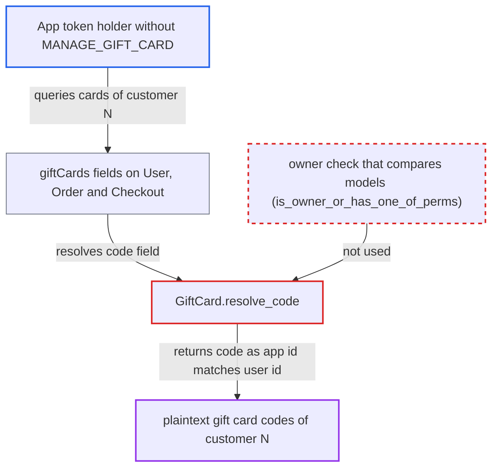

# GiftCard.code owner check compares App primary key against user ids

| Field | Value |
|---|---|
| ID | `find_01UwHiZZ9Nj1DPX5RZKyDqty` |
| Severity | **Low** |
| Status | open |
| CWE | CWE-863 — Incorrect authorization |
| Created | 2026-10-27T21:17:54.162436Z |
| Claude Security | https://claude.ai/security/findings/find_01UwHiZZ9Nj1DPX5RZKyDqty |

## Description

An API app that lacks the gift card permission can read the full, plaintext gift card codes of one customer, the customer whose user id equals the app's id. Codes are bearer secrets, so codes for cards not assigned to anyone can then be spent. The attack needs an app token with `MANAGE_USERS` or `MANAGE_ORDERS`. The cause is `GiftCard.resolve_code`, which compares an `App` primary key with `User` ids.

1. **app token holder** reads its own app id N. The app has `MANAGE_USERS` or `MANAGE_ORDERS` but not `MANAGE_GIFT_CARD`, and customer N must exist and have used or been assigned gift cards.
2. **app token holder** queries the gift cards of customer N through `user(id: "User:N") { giftCards }`. `User.giftCards` has no permission of its own and lists every card whose `used_by_id` or `assigned_to_id` is that user, and `user(id:)` is open to apps with `MANAGE_USERS` or `MANAGE_ORDERS`. ([`saleor/graphql/account/types.py:746-758`](https://github.com/cx-benchmark/saleor/blob/c982006cc04c77a97def93218dedac8d715eb041/saleor/graphql/account/types.py#L746-L758))
3. **the helper `get_user_or_app_from_context`** returns the `App` as the requestor. It returns `context.app or context.user`, and for app-token requests `request.user` is None. ([`saleor/graphql/utils/__init__.py:204-207`](https://github.com/cx-benchmark/saleor/blob/c982006cc04c77a97def93218dedac8d715eb041/saleor/graphql/utils/__init__.py#L204-L207))
4. **the resolver `GiftCard.resolve_code`** treats the app as the card owner and returns the plaintext `code`. It checks `requestor.pk in owner_ids`, so an `App` whose pk is N matches `User` ids equal to N, because the two tables use separate integer id sequences. ([`saleor/graphql/giftcard/types.py:479-499`](https://github.com/cx-benchmark/saleor/blob/c982006cc04c77a97def93218dedac8d715eb041/saleor/graphql/giftcard/types.py#L479-L499))
5. **app token holder** spends a leaked code of an unassigned card through `checkoutAddPromoCode`. `add_gift_card_code_to_checkout` accepts any active code and refuses only assigned cards, so the leaked code works from the attacker's own checkout. ([`saleor/giftcard/utils.py:55-84`](https://github.com/cx-benchmark/saleor/blob/c982006cc04c77a97def93218dedac8d715eb041/saleor/giftcard/utils.py#L55-L84))

## Assessment

The attacker holds an app token with `MANAGE_USERS` or `MANAGE_ORDERS` but not `MANAGE_GIFT_CARD`. The app's id must equal the id of a customer who has used or been assigned gift cards. Besides `user(id:) { giftCards }`, the cards can be reached through `orders { giftCards }`, `checkout { giftCards }` and `ORDER_*` or `CHECKOUT_*` webhook subscription payloads, which also set the `App` as requestor. A staff member with `MANAGE_APPS` but without `MANAGE_GIFT_CARD` can choose the victim by calling `appCreate` repeatedly until the app id sequence reaches that customer's id. No action by the victim is needed.

Impact: The attacker learns the plaintext gift card codes of one customer per app id. Codes for cards not assigned to anyone can be redeemed through `checkoutAddPromoCode` to spend that customer's remaining balance. The reach is limited to one customer's cards per app id.

## Recommendation

`GiftCard.resolve_code` decides ownership by comparing the raw integer pk of a requestor that may be an `App` against `User` ids, which mixes two separate id spaces.

Fix criteria: The owner test succeeds only for a `User` requestor whose identity equals `used_by` or `assigned_to`, for example by comparing model instances or checking `isinstance(requestor, User)` before comparing ids. An `App` gets the code only through `MANAGE_GIFT_CARD`. A test confirms that an app whose pk equals a card's `used_by_id` and which lacks `MANAGE_GIFT_CARD` gets `PermissionDenied` for `code`.

## Evidence

**https://github.com/cx-benchmark/saleor**

- [`saleor/graphql/giftcard/types.py:479-499`](https://github.com/cx-benchmark/saleor/blob/c982006cc04c77a97def93218dedac8d715eb041/saleor/graphql/giftcard/types.py#L479-L499)
- [`saleor/graphql/utils/__init__.py:204-207`](https://github.com/cx-benchmark/saleor/blob/c982006cc04c77a97def93218dedac8d715eb041/saleor/graphql/utils/__init__.py#L204-L207)
- [`saleor/graphql/context.py:77-91`](https://github.com/cx-benchmark/saleor/blob/c982006cc04c77a97def93218dedac8d715eb041/saleor/graphql/context.py#L77-L91)
- [`saleor/graphql/account/resolvers.py:76-110`](https://github.com/cx-benchmark/saleor/blob/c982006cc04c77a97def93218dedac8d715eb041/saleor/graphql/account/resolvers.py#L76-L110)
- [`saleor/graphql/account/types.py:746-758`](https://github.com/cx-benchmark/saleor/blob/c982006cc04c77a97def93218dedac8d715eb041/saleor/graphql/account/types.py#L746-L758)
- [`saleor/graphql/checkout/types.py:1173-1175`](https://github.com/cx-benchmark/saleor/blob/c982006cc04c77a97def93218dedac8d715eb041/saleor/graphql/checkout/types.py#L1173-L1175)
- [`saleor/giftcard/utils.py:55-84`](https://github.com/cx-benchmark/saleor/blob/c982006cc04c77a97def93218dedac8d715eb041/saleor/giftcard/utils.py#L55-L84)

