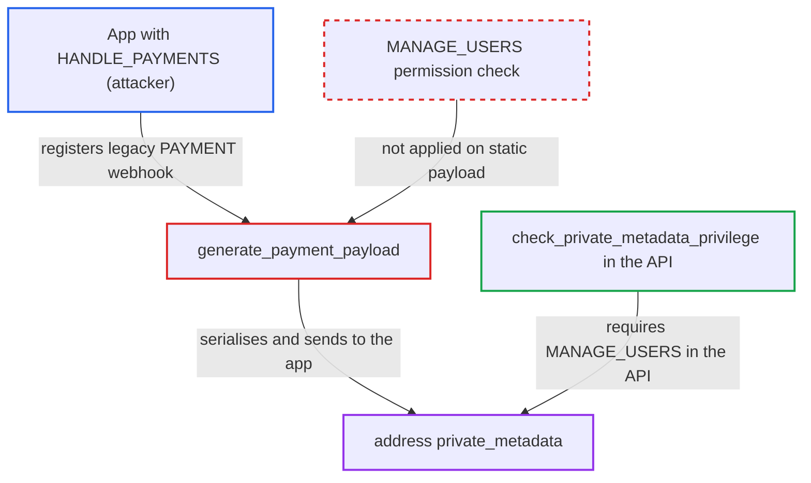

# Legacy PAYMENT_* webhook payload discloses address private metadata to HANDLE_PAYMENTS apps

| Field | Value |
|---|---|
| ID | `find_012BFQgZcTYRRkNjhJ3XkBsD` |
| Severity | **Low** |
| Status | open |
| CWE | CWE-201 — Information exposure |
| Created | 2026-10-27T21:45:21.665821Z |
| Claude Security | https://claude.ai/security/findings/find_012BFQgZcTYRRkNjhJ3XkBsD |

## Description

A malicious or compromised app with `HANDLE_PAYMENTS` can read the private metadata of customers' billing and shipping addresses. The API reserves that data for `MANAGE_USERS`. The app needs a legacy (non-subscription) `PAYMENT_*` webhook on a gateway it owns. It only gets data if someone stored private metadata on those addresses. The cause is `generate_payment_payload`, which serialises the whole `PaymentData` including address `private_metadata`.

1. **staff, an app or an order import** stores private metadata on checkout or order addresses. The report names `updatePrivateMetadata` (needs `MANAGE_USERS`) and `orderBulkCreate`, and `checkoutComplete` keeps the data when it copies checkout addresses into the order. ([`saleor/graphql/order/bulk_mutations/order_bulk_create.py:1084-1130`](https://github.com/cx-benchmark/saleor/blob/c982006cc04c77a97def93218dedac8d715eb041/saleor/graphql/order/bulk_mutations/order_bulk_create.py#L1084-L1130))
2. **the attacking app** registers a legacy webhook with no subscription query for `PAYMENT_PROCESS`, `PAYMENT_AUTHORIZE` or `PAYMENT_CAPTURE`. The app needs `HANDLE_PAYMENTS` and must own the payment's gateway id, so only payments routed through its gateway reach it.
3. **`create_payment_information`** builds the billing and shipping `AddressData` from the checkout's or order's addresses. It calls `Address.as_data()`, which drops only `id` and `user`, so `metadata` and `private_metadata` are copied in, and `AddressData` declares both fields. ([`saleor/payment/utils.py:279-310`](https://github.com/cx-benchmark/saleor/blob/c982006cc04c77a97def93218dedac8d715eb041/saleor/payment/utils.py#L279-L310))
4. **`generate_payment_payload`** serialises the whole `PaymentData` with `asdict` and `json.dumps`. Nothing removes `private_metadata` from the nested `billing` and `shipping` objects. ([`saleor/webhook/payloads.py:1052-1064`](https://github.com/cx-benchmark/saleor/blob/c982006cc04c77a97def93218dedac8d715eb041/saleor/webhook/payloads.py#L1052-L1064))
5. **`__run_payment_webhook`** sends the payload to the gateway's app as a static payload. Without a `subscription_query` the payload is delivered verbatim, so no permission check runs on the fields. ([`saleor/webhook/transport/synchronous/transport.py:423-441`](https://github.com/cx-benchmark/saleor/blob/c982006cc04c77a97def93218dedac8d715eb041/saleor/webhook/transport/synchronous/transport.py#L423-L441))

## Assessment

The attacker runs a malicious or compromised app with `HANDLE_PAYMENTS` that serves a payment gateway. It registers a legacy webhook without a subscription query for `PAYMENT_PROCESS`, `PAYMENT_AUTHORIZE` or `PAYMENT_CAPTURE`. The payload is sent when customers pay through its gateway, or when staff capture, refund or void such payments. The leak only yields data if staff or other apps stored private metadata on the addresses, which the attacker does not control. The data gets there through `updatePrivateMetadata` on checkout or order address ids (needs `MANAGE_USERS`), through `orderBulkCreate`, or through `checkoutComplete`, which keeps it when copying checkout addresses into the order. Saved user addresses are not copied into checkouts by `checkoutCreate`. Warehouse address private metadata cannot be written through the API, so click-and-collect copies add nothing in practice.

Impact: The app reads the `private_metadata` of billing and shipping addresses, which the API allows only with `MANAGE_USERS`. It sees this only for checkout and order addresses of payments routed through its own gateway. What it gets depends on what operators or other apps stored there. Address fields and public metadata are already readable to it, and nothing can be changed or disrupted.

## Recommendation

`generate_payment_payload` serialises `AddressData` wholesale. Address `private_metadata`, which the API gates behind `MANAGE_USERS` or `MANAGE_STAFF`, is therefore sent to the gateway's `HANDLE_PAYMENTS` app over the legacy payment webhooks.

Fix criteria: The body of every legacy `PAYMENT_*` webhook has no `private_metadata` under `billing` or `shipping`. It can be stripped in the payload generator, or left out of `AddressData` on the webhook path. In-process gateways still work. To verify, set private metadata on a checkout's billing address and complete payment through an app gateway with a legacy `PAYMENT_PROCESS` webhook. Confirm the delivered body has no `private_metadata` key under `billing` or `shipping`. Repeat for capture and refund on the resulting order.

## Evidence

**https://github.com/cx-benchmark/saleor**

- [`saleor/webhook/payloads.py:1052-1064`](https://github.com/cx-benchmark/saleor/blob/c982006cc04c77a97def93218dedac8d715eb041/saleor/webhook/payloads.py#L1052-L1064)
- [`saleor/payment/utils.py:279-310`](https://github.com/cx-benchmark/saleor/blob/c982006cc04c77a97def93218dedac8d715eb041/saleor/payment/utils.py#L279-L310)
- [`saleor/account/models.py:115-129`](https://github.com/cx-benchmark/saleor/blob/c982006cc04c77a97def93218dedac8d715eb041/saleor/account/models.py#L115-L129)
- [`saleor/payment/interface.py:329-343`](https://github.com/cx-benchmark/saleor/blob/c982006cc04c77a97def93218dedac8d715eb041/saleor/payment/interface.py#L329-L343)
- [`saleor/plugins/webhook/plugin.py:3069-3146`](https://github.com/cx-benchmark/saleor/blob/c982006cc04c77a97def93218dedac8d715eb041/saleor/plugins/webhook/plugin.py#L3069-L3146)
- [`saleor/webhook/transport/synchronous/transport.py:423-441`](https://github.com/cx-benchmark/saleor/blob/c982006cc04c77a97def93218dedac8d715eb041/saleor/webhook/transport/synchronous/transport.py#L423-L441)
- [`saleor/graphql/meta/permissions.py:142-174`](https://github.com/cx-benchmark/saleor/blob/c982006cc04c77a97def93218dedac8d715eb041/saleor/graphql/meta/permissions.py#L142-L174)
- [`saleor/webhook/payloads.py:62-74`](https://github.com/cx-benchmark/saleor/blob/c982006cc04c77a97def93218dedac8d715eb041/saleor/webhook/payloads.py#L62-L74)
- [`saleor/checkout/complete_checkout.py:209-217`](https://github.com/cx-benchmark/saleor/blob/c982006cc04c77a97def93218dedac8d715eb041/saleor/checkout/complete_checkout.py#L209-L217)
- [`saleor/graphql/order/bulk_mutations/order_bulk_create.py:1084-1130`](https://github.com/cx-benchmark/saleor/blob/c982006cc04c77a97def93218dedac8d715eb041/saleor/graphql/order/bulk_mutations/order_bulk_create.py#L1084-L1130)

