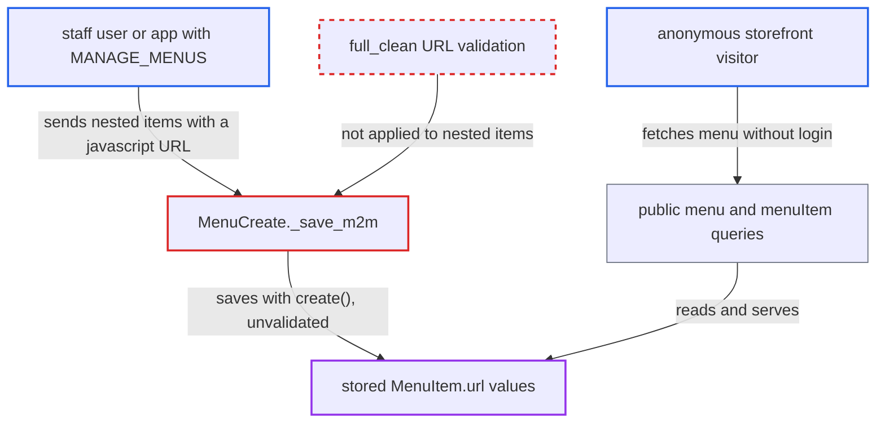

# menuCreate saves nested menu items without model validation, allowing javascript: navigation URLs

| Field | Value |
|---|---|
| ID | `find_01KnPLr9YeWmMB86UfgTUGJz` |
| Severity | **Low** |
| Status | open |
| CWE | CWE-1173 — Improper use of validation framework |
| Created | 2026-10-27T21:23:07.035311Z |
| Claude Security | https://claude.ai/security/findings/find_01KnPLr9YeWmMB86UfgTUGJz |

## Description

A staff user or app with the `MANAGE_MENUS` permission can store menu links with any URL scheme, such as `javascript:`, and the public API then serves them to anonymous visitors. The harm is limited to storefronts that put the value into a link without their own scheme filtering, and only when a visitor clicks. The cause is `MenuCreate._save_m2m`, which saves nested items with `instance.items.create(**item)` and skips the model's URL validation.

1. **attacker with `MANAGE_MENUS`** sends `menuCreate` with a nested `items` list containing a `url` such as `javascript:alert(document.domain)`. The nested `url` field is a plain `graphene.String`, so the GraphQL layer does not check its scheme. ([`saleor/graphql/menu/mutations/menu_item_create.py:22-31`](https://github.com/cx-benchmark/saleor/blob/c982006cc04c77a97def93218dedac8d715eb041/saleor/graphql/menu/mutations/menu_item_create.py#L22-L31))
2. **the method `MenuCreate.clean_input`** checks only that each item has one target and passes the `url` through unchanged. It does not look at the scheme of the `url` string. ([`saleor/graphql/menu/mutations/menu_create.py:63-102`](https://github.com/cx-benchmark/saleor/blob/c982006cc04c77a97def93218dedac8d715eb041/saleor/graphql/menu/mutations/menu_create.py#L63-L102))
3. **the method `perform_mutation`** runs model validation only on the parent `Menu`. `clean_instance` calls `full_clean()` on the top-level instance, so the nested items are never validated. ([`saleor/graphql/core/mutations.py:846-852`](https://github.com/cx-benchmark/saleor/blob/c982006cc04c77a97def93218dedac8d715eb041/saleor/graphql/core/mutations.py#L846-L852))
4. **the method `_save_m2m`** stores each nested item with `instance.items.create(**item)`. `QuerySet.create()` never calls `full_clean()`, so the `URLValidator` on `MenuItem.url` (allowed schemes `http`, `https`, `ftp`, `ftps`) does not run. ([`saleor/graphql/menu/mutations/menu_create.py:106-114`](https://github.com/cx-benchmark/saleor/blob/c982006cc04c77a97def93218dedac8d715eb041/saleor/graphql/menu/mutations/menu_create.py#L106-L114))
5. **public `menu`, `menus`, `menuItem` and `menuItems` queries** return the stored `url` to anonymous clients. `MenuItem.url` is exposed as a raw `String` and these queries need no permission. ([`saleor/graphql/menu/types.py:109`](https://github.com/cx-benchmark/saleor/blob/c982006cc04c77a97def93218dedac8d715eb041/saleor/graphql/menu/types.py#L109))
6. **a storefront and its visitor** renders the value into an `href` and the visitor clicks it. The script then runs in the storefront's origin. This happens only if the storefront does not filter schemes itself.

## Assessment

The attacker is a staff user or app holding `MANAGE_MENUS`. They send `menuCreate` to the `/graphql/` endpoint with nested `items` whose `url` has a scheme like `javascript:` or `data:`, up to the 256-character column limit. To replace a live storefront menu, they can first run `menuDelete` on it and then `menuCreate` a menu with the same slug. The attack works only if the storefront puts `url` into an `href` without its own scheme filtering, which the attacker does not control. A visitor must also click the link. Some client frameworks, such as recent React versions, block `javascript:` hrefs. This repository is headless and has no code that renders `MenuItem.url`.

Impact: On the Saleor API itself, the attacker only writes menu records that `MANAGE_MENUS` already lets them write, with a value that breaks the field's declared format. The report finds no data disclosed, no other records changed and no effect on service.

Subsequent-system impact: In a storefront that renders the link unfiltered, a clicked `javascript:` URL runs in the storefront origin. It can read the customer's storefront-held session token and checkout data and act as that visitor. This is limited to visitors who click, and to what that origin's script can reach.

## Recommendation

`MenuCreate._save_m2m` creates nested `MenuItem` rows with `QuerySet.create()`. This skips the `URLField` and `URLValidator` model validation that `menuItemCreate` and `menuItemUpdate` enforce through `full_clean()`, so unvalidated link schemes reach the public menu queries.

Fix criteria: Every `MenuItem` saved through `menuCreate` passes the same URL validation as `menuItemCreate`, or an explicit `http`/`https` allow-list, before anything is stored. An invalid item returns a `MenuError` and rolls back the whole menu. Check: `menuCreate` with a nested item whose `url` is `javascript:alert(1)` or `data:text/html,...` is rejected and creates no `Menu` or `MenuItem`. Items with `https://` URLs still succeed.

## Evidence

**https://github.com/cx-benchmark/saleor**

- [`saleor/graphql/menu/mutations/menu_create.py:106-114`](https://github.com/cx-benchmark/saleor/blob/c982006cc04c77a97def93218dedac8d715eb041/saleor/graphql/menu/mutations/menu_create.py#L106-L114)
- [`saleor/graphql/menu/mutations/menu_create.py:63-102`](https://github.com/cx-benchmark/saleor/blob/c982006cc04c77a97def93218dedac8d715eb041/saleor/graphql/menu/mutations/menu_create.py#L63-L102)
- [`saleor/graphql/menu/mutations/menu_item_create.py:22-31`](https://github.com/cx-benchmark/saleor/blob/c982006cc04c77a97def93218dedac8d715eb041/saleor/graphql/menu/mutations/menu_item_create.py#L22-L31)
- [`saleor/menu/models.py:32`](https://github.com/cx-benchmark/saleor/blob/c982006cc04c77a97def93218dedac8d715eb041/saleor/menu/models.py#L32)
- [`saleor/graphql/core/mutations.py:846-852`](https://github.com/cx-benchmark/saleor/blob/c982006cc04c77a97def93218dedac8d715eb041/saleor/graphql/core/mutations.py#L846-L852)
- [`saleor/graphql/menu/types.py:109`](https://github.com/cx-benchmark/saleor/blob/c982006cc04c77a97def93218dedac8d715eb041/saleor/graphql/menu/types.py#L109)
- [`saleor/core/editorjs/cleaners.py:11-45`](https://github.com/cx-benchmark/saleor/blob/c982006cc04c77a97def93218dedac8d715eb041/saleor/core/editorjs/cleaners.py#L11-L45)

