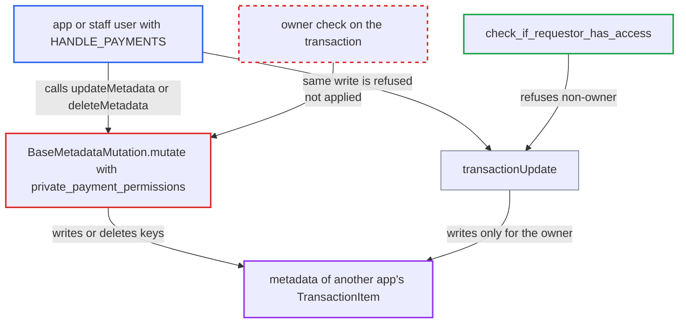

# Metadata mutations let any HANDLE_PAYMENTS app or staff rewrite other apps' TransactionItem metadata

| Field | Value |
|---|---|
| ID | `find_01X9BD1n9S5SGeJv7LwhC339` |
| Severity | **Low** |
| Status | open |
| CWE | CWE-862 — Missing Authorization |
| Created | 2026-10-27T21:29:20.009652Z |
| Claude Security | https://claude.ai/security/findings/find_01X9BD1n9S5SGeJv7LwhC339 |

## Description

An app or staff user with `HANDLE_PAYMENTS` can overwrite or delete the public and private metadata of a payment transaction owned by a different app. The impact is limited to data-level tampering. The cause is that the generic metadata mutations authorize `TransactionItem` through `private_payment_permissions`, which only returns `[HANDLE_PAYMENTS]` and never checks the transaction's owner.

1. **attacker (app or staff user with `HANDLE_PAYMENTS`)** obtains the id of a transaction owned by another app. For transactions made by `transactionCreate` the id is the sequential `TransactionItem:<n>`. Otherwise a token seen through `MANAGE_ORDERS` or a staff listing works. ([`saleor/graphql/payment/types.py:928-940`](https://github.com/cx-benchmark/saleor/blob/c982006cc04c77a97def93218dedac8d715eb041/saleor/graphql/payment/types.py#L928-L940))
2. **attacker** calls `updateMetadata`, `updatePrivateMetadata`, `deleteMetadata` or `deletePrivateMetadata` with that id. These generic metadata mutations take any `TransactionItem`, so the attacker skips `transactionUpdate` and `transactionEventReport`, which enforce the owner rule. ([`saleor/graphql/meta/permissions.py:339`](https://github.com/cx-benchmark/saleor/blob/c982006cc04c77a97def93218dedac8d715eb041/saleor/graphql/meta/permissions.py#L339))
3. **the resolver `private_payment_permissions`** returns `[HANDLE_PAYMENTS]` for any app or staff user. It never loads the transaction or compares its `app_id`/`app_identifier` with the requester, so the permission check passes. ([`saleor/graphql/meta/permissions.py:290-296`](https://github.com/cx-benchmark/saleor/blob/c982006cc04c77a97def93218dedac8d715eb041/saleor/graphql/meta/permissions.py#L290-L296))
4. **`BaseMetadataMutation.mutate`** loads the transaction and writes or deletes the metadata keys. It checks only the type-level permission list, and `TransactionItem.get_node` resolves the transaction with no owner filter. ([`saleor/graphql/meta/mutations/base.py:156-172`](https://github.com/cx-benchmark/saleor/blob/c982006cc04c77a97def93218dedac8d715eb041/saleor/graphql/meta/mutations/base.py#L156-L172))
5. **Saleor** fires `TRANSACTION_ITEM_METADATA_UPDATED`. The event is sent for the change, even though the owner rule would have refused the same write through `transactionUpdate`.

## Assessment

The attacker is an installed app (or an app whose token has leaked) holding `HANDLE_PAYMENTS`, or a staff user holding `HANDLE_PAYMENTS`. They need the id of a transaction that another app owns. No victim interaction is needed. Any of the four mutations `updateMetadata`, `updatePrivateMetadata`, `deleteMetadata` and `deletePrivateMetadata` works as the way in.

Impact: The attacker can overwrite or delete the public and private metadata of payment transactions that another app owns. The report rates this as limited data tampering, because Saleor core makes no decision from transaction metadata. It exposes no new data, since `transaction(id)` already shows private metadata to `HANDLE_PAYMENTS`. Availability is not affected.

## Recommendation

For `TransactionItem`, metadata permission resolution in `saleor/graphql/meta/permissions.py` works only at type level. It ignores the owner rule that `transactionUpdate` and `transactionEventReport` enforce through `check_if_requestor_has_access`.

Fix criteria: Public and private metadata writes and deletes on a `TransactionItem` apply the same owner rule as `transactionUpdate`. An app succeeds only on transactions whose `app_id`/`app_identifier` match it or that have no owner, and staff are refused on app-owned transactions. An app with `HANDLE_PAYMENTS` gets a permission error from `updatePrivateMetadata` or `deleteMetadata` on another app's transaction. The stored metadata stays unchanged and no webhook fires. The same call on the app's own transaction succeeds.

## Evidence

**https://github.com/cx-benchmark/saleor**

- [`saleor/graphql/meta/permissions.py:290-296`](https://github.com/cx-benchmark/saleor/blob/c982006cc04c77a97def93218dedac8d715eb041/saleor/graphql/meta/permissions.py#L290-L296)
- [`saleor/graphql/meta/permissions.py:339`](https://github.com/cx-benchmark/saleor/blob/c982006cc04c77a97def93218dedac8d715eb041/saleor/graphql/meta/permissions.py#L339)
- [`saleor/graphql/meta/permissions.py:379`](https://github.com/cx-benchmark/saleor/blob/c982006cc04c77a97def93218dedac8d715eb041/saleor/graphql/meta/permissions.py#L379)
- [`saleor/graphql/meta/mutations/base.py:156-172`](https://github.com/cx-benchmark/saleor/blob/c982006cc04c77a97def93218dedac8d715eb041/saleor/graphql/meta/mutations/base.py#L156-L172)
- [`saleor/graphql/payment/types.py:928-940`](https://github.com/cx-benchmark/saleor/blob/c982006cc04c77a97def93218dedac8d715eb041/saleor/graphql/payment/types.py#L928-L940)
- [`saleor/graphql/payment/mutations/transaction/transaction_update.py:91-105`](https://github.com/cx-benchmark/saleor/blob/c982006cc04c77a97def93218dedac8d715eb041/saleor/graphql/payment/mutations/transaction/transaction_update.py#L91-L105)
- [`saleor/graphql/payment/mutations/transaction/transaction_event_report.py:324-332`](https://github.com/cx-benchmark/saleor/blob/c982006cc04c77a97def93218dedac8d715eb041/saleor/graphql/payment/mutations/transaction/transaction_event_report.py#L324-L332)
- [`saleor/graphql/payment/utils.py:22-46`](https://github.com/cx-benchmark/saleor/blob/c982006cc04c77a97def93218dedac8d715eb041/saleor/graphql/payment/utils.py#L22-L46)
- [`saleor/graphql/payment/schema.py:115-121`](https://github.com/cx-benchmark/saleor/blob/c982006cc04c77a97def93218dedac8d715eb041/saleor/graphql/payment/schema.py#L115-L121)

