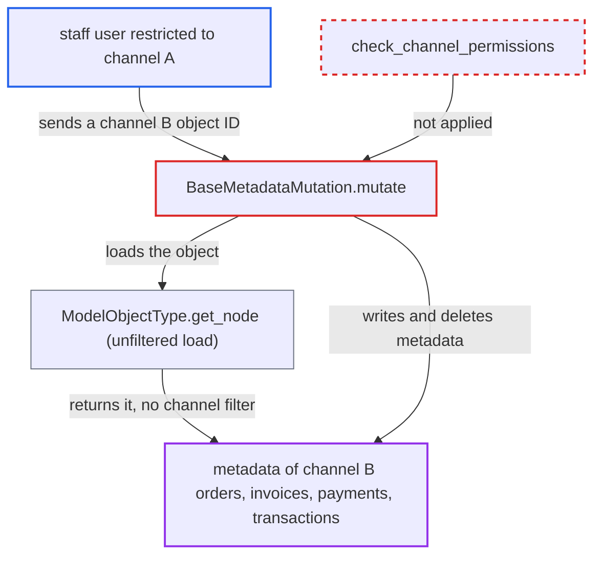

# Metadata mutations skip channel-access check for orders, invoices, payments and transactions

| Field | Value |
|---|---|
| ID | `find_01Fx5Ez87HGfqt69d6Lwdfm6` |
| Severity | **Low** |
| Status | open |
| CWE | CWE-862 — Missing Authorization |
| Created | 2026-10-27T21:26:58.393239Z |
| Claude Security | https://claude.ai/security/findings/find_01Fx5Ez87HGfqt69d6Lwdfm6 |

## Description

A staff member whose permission groups are restricted to channel A can change public and private metadata on orders, order lines, fulfillments, invoices, payments and transactions in channel B. This needs a group with `restricted_access_to_channels`, a permission such as `MANAGE_ORDERS` or `HANDLE_PAYMENTS`, and the global ID of the target. `BaseMetadataMutation.mutate` checks only the permission tied to the object's type name and never checks the object's channel.

1. **restricted staff user** gets the global ID of an object in channel B. The object can be an order, order line, fulfillment, invoice, payment or transaction, and the ID may be leaked or, for legacy `use_old_id` orders, written as `Order:<number>`.
2. **restricted staff user** calls `updatePrivateMetadata`, `updateMetadata`, `deleteMetadata` or `deletePrivateMetadata` with that ID. The user holds `MANAGE_ORDERS`, `HANDLE_TAXES` or `HANDLE_PAYMENTS` for channel A, and these generic mutations accept any object ID. ([`saleor/graphql/meta/mutations/base.py:155-185`](https://github.com/cx-benchmark/saleor/blob/c982006cc04c77a97def93218dedac8d715eb041/saleor/graphql/meta/mutations/base.py#L155-L185))
3. **the handler `BaseMetadataMutation.mutate`** checks only the permission tied to the object's type name. `order_permissions` and `invoice_permissions` return fixed lists, and the payment permission functions return `HANDLE_PAYMENTS` for any staff user without looking at the object's channel. ([`saleor/graphql/meta/permissions.py:189-196`](https://github.com/cx-benchmark/saleor/blob/c982006cc04c77a97def93218dedac8d715eb041/saleor/graphql/meta/permissions.py#L189-L196))
4. **the payment permission functions** grant `HANDLE_PAYMENTS` for payments and transactions. `public_payment_permissions` and `private_payment_permissions` never look at the channel of the `Payment` or `TransactionItem`. ([`saleor/graphql/meta/permissions.py:277-297`](https://github.com/cx-benchmark/saleor/blob/c982006cc04c77a97def93218dedac8d715eb041/saleor/graphql/meta/permissions.py#L277-L297))
5. **`ModelObjectType.get_node`** loads the object without any channel filter. It uses a plain `model.objects.get`, so an object from a channel the user is excluded from resolves normally. ([`saleor/graphql/core/types/model.py:63-81`](https://github.com/cx-benchmark/saleor/blob/c982006cc04c77a97def93218dedac8d715eb041/saleor/graphql/core/types/model.py#L63-L81))
6. **`update_metadata`, `update_private_metadata` and the `delete_*_keys` helpers** write the change and return the object. Metadata-updated webhooks fire, and the `item` field of the response returns the out-of-channel object to the restricted user. ([`saleor/graphql/meta/mutations/base.py:155-185`](https://github.com/cx-benchmark/saleor/blob/c982006cc04c77a97def93218dedac8d715eb041/saleor/graphql/meta/mutations/base.py#L155-L185))

## Assessment

The attacker is a staff user in a permission group limited to channel A through `restricted_access_to_channels`, which is off by default. The user holds `MANAGE_ORDERS` (or `HANDLE_TAXES`, or `HANDLE_PAYMENTS` for payments and transactions) and must know the global ID of a channel B object. Such an ID may be leaked, or be `Order:<number>` for legacy `use_old_id` orders. Apps are not affected by the channel check, so the report treats staff users as the attackers.

Impact: The attacker can add, overwrite or delete public and private metadata on orders, order lines, fulfillments, invoices, payments and transactions in channels they are excluded from. This includes keys the platform and apps rely on, such as `external_app_shipping_id`, which `Order.resolve_shipping_method` reads. It also triggers metadata-updated webhooks and exposes the object's fields and metadata through the `item` response. Order totals, status and payment state cannot be changed this way, and availability is not affected.

## Recommendation

The metadata update and delete mutations authorize Order, OrderLine, Fulfillment, Invoice, Payment and TransactionItem by type permission only. They never apply the staff channel-access restriction that the dedicated order, invoice and payment mutations enforce.

Fix criteria: For every channel-scoped object type, the metadata update and delete mutations reject a staff requester whose accessible channels do not include the object's channel. The semantics match `check_channel_permissions`, and apps are unaffected. A `MANAGE_ORDERS` user restricted to channel A gets a permission error when updating or deleting public or private metadata on a channel B order, line, fulfillment or invoice. A user with `HANDLE_PAYMENTS` gets the same error on a channel B payment or transaction. The same user still succeeds on channel A objects.

## Evidence

**https://github.com/cx-benchmark/saleor**

- [`saleor/graphql/meta/mutations/base.py:155-185`](https://github.com/cx-benchmark/saleor/blob/c982006cc04c77a97def93218dedac8d715eb041/saleor/graphql/meta/mutations/base.py#L155-L185)
- [`saleor/graphql/meta/permissions.py:189-196`](https://github.com/cx-benchmark/saleor/blob/c982006cc04c77a97def93218dedac8d715eb041/saleor/graphql/meta/permissions.py#L189-L196)
- [`saleor/graphql/meta/permissions.py:277-297`](https://github.com/cx-benchmark/saleor/blob/c982006cc04c77a97def93218dedac8d715eb041/saleor/graphql/meta/permissions.py#L277-L297)
- [`saleor/graphql/core/types/model.py:63-81`](https://github.com/cx-benchmark/saleor/blob/c982006cc04c77a97def93218dedac8d715eb041/saleor/graphql/core/types/model.py#L63-L81)
- [`saleor/graphql/order/mutations/order_update.py:253-256`](https://github.com/cx-benchmark/saleor/blob/c982006cc04c77a97def93218dedac8d715eb041/saleor/graphql/order/mutations/order_update.py#L253-L256)
- [`saleor/graphql/core/mutations.py:585-597`](https://github.com/cx-benchmark/saleor/blob/c982006cc04c77a97def93218dedac8d715eb041/saleor/graphql/core/mutations.py#L585-L597)
- [`saleor/order/delivery_context.py:113-115`](https://github.com/cx-benchmark/saleor/blob/c982006cc04c77a97def93218dedac8d715eb041/saleor/order/delivery_context.py#L113-L115)

