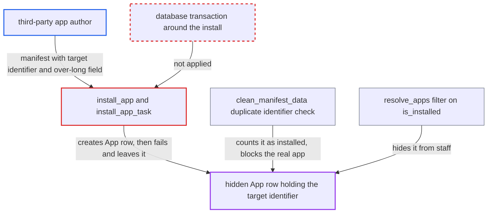

# Non-atomic install_app leaves hidden App rows that squat identifiers after manifest-triggered failure

| Field | Value |
|---|---|
| ID | `find_01989pKfsf87vp5ZgGhvRSaE` |
| Severity | **Low** |
| Status | open |
| CWE | CWE-459 — Improper resource shutdown |
| Created | 2026-10-27T21:23:51.808578Z |
| Claude Security | https://claude.ai/security/findings/find_01989pKfsf87vp5ZgGhvRSaE |

## Description

A third-party app author can permanently block installation of another app, for example `app.saleor.stripe`. They do it by getting a hidden, half-created app record left in the database. It needs a staff user with `MANAGE_APPS` to install the attacker's manifest. The cause is `install_app()`, which writes the `App` row and its extensions, webhooks and token without a transaction. It also never checks manifest values against the column lengths of those later rows.

1. **third-party app author** serves a manifest that uses another app's identifier and has an over-long field. The manifest's `id` is the target app's identifier, and an extension URL is over 200 characters, which `AppExtension.url` cannot store, though the manifest validation allows up to 2048. ([`saleor/app/models.py:164-168`](https://github.com/cx-benchmark/saleor/blob/c982006cc04c77a97def93218dedac8d715eb041/saleor/app/models.py#L164-L168))
2. **staff user with `MANAGE_APPS`** installs the manifest through `appInstall`. The manifest passes `clean_manifest_data` because only the format of its values is checked, not the column lengths of the rows created later.
3. **the function `install_app()`** creates the `App` row and its permissions, then fails on the extension insert. `App.objects.create` succeeds, then `AppExtension.objects.create` raises `DataError`, and no transaction rolls back the earlier writes. ([`saleor/app/installation_utils.py:240-346`](https://github.com/cx-benchmark/saleor/blob/c982006cc04c77a97def93218dedac8d715eb041/saleor/app/installation_utils.py#L240-L346))
4. **the task `install_app_task`** catches the error, marks the installation `FAILED` and leaves the `App` row. The task is decorated only with `allow_writer()`, which is not atomic, and it never deletes the partly created `App`, which keeps `is_installed=False` and the manifest's `identifier`. ([`saleor/app/tasks.py:23-62`](https://github.com/cx-benchmark/saleor/blob/c982006cc04c77a97def93218dedac8d715eb041/saleor/app/tasks.py#L23-L62))
5. **the check in `clean_manifest_data`** refuses any later manifest with the same `id`. The duplicate check uses `App.objects.not_removed()` without `is_installed=True`, so the leftover row counts as an installed app. ([`saleor/app/manifest_validations.py:148-158`](https://github.com/cx-benchmark/saleor/blob/c982006cc04c77a97def93218dedac8d715eb041/saleor/app/manifest_validations.py#L148-L158))
6. **the resolver `resolve_apps`** hides the leftover row from the API. It filters on `is_installed=True`, so staff cannot see or delete the row and an operator must clean the database. ([`saleor/graphql/app/resolvers.py:24-29`](https://github.com/cx-benchmark/saleor/blob/c982006cc04c77a97def93218dedac8d715eb041/saleor/graphql/app/resolvers.py#L24-L29))

## Assessment

The attacker is a third-party app author who serves a manifest whose `id` is another app's identifier. The manifest also has an extension `url` over 200 characters, or a webhook `name` or `targetUrl` over 255. A staff user with `MANAGE_APPS` must install it through `appInstall`. No further action is needed, and the effect lasts until someone cleans the database by hand. A second way to leave an orphan is the `ValidationError` branch in `install_app_task`. It writes an untruncated message into the 255-character `Job.message` column. If that save fails, the installation stays `PENDING`, and neither `appRetryInstall` nor `appDeleteFailedInstallation` accepts it.

Impact: The genuine app with the squatted identifier cannot be installed until an operator removes the row from the database. The hidden row is also considered when a payment app is looked up by identifier in `_create_transaction_data` and `get_webhooks_for_event(apps_identifier=...)`. No data is disclosed, and the report describes the damage to the app registry as limited.

## Recommendation

(1) App installation does several dependent writes with no transaction. It also does not check manifest values against the column limits of the extension and webhook rows. A late failure therefore leaves a partly created app.

Fix criteria: Creating the `App`, its permissions, extensions, webhooks and token is all-or-nothing, or any failure deletes the created `App`. Manifest fields are checked against the stored column lengths before any write. A manifest with an over-long extension URL or webhook name fails installation and leaves no `App` row. Re-installing a manifest with that identifier then succeeds.

(2) The `ValidationError` branch of `install_app_task` writes an unbounded message into a 255-character column. The save of the failure record can fail, which leaves the installation `PENDING`.

Fix criteria: Every path that saves an installation failure truncates the message, as `set_message` does. The installation always reaches `FAILED`. It can then be retried or deleted through the API.

## Evidence

**https://github.com/cx-benchmark/saleor**

- [`saleor/app/installation_utils.py:240-346`](https://github.com/cx-benchmark/saleor/blob/c982006cc04c77a97def93218dedac8d715eb041/saleor/app/installation_utils.py#L240-L346)
- [`saleor/app/tasks.py:23-62`](https://github.com/cx-benchmark/saleor/blob/c982006cc04c77a97def93218dedac8d715eb041/saleor/app/tasks.py#L23-L62)
- [`saleor/app/models.py:164-168`](https://github.com/cx-benchmark/saleor/blob/c982006cc04c77a97def93218dedac8d715eb041/saleor/app/models.py#L164-L168)
- [`saleor/app/manifest_validations.py:148-158`](https://github.com/cx-benchmark/saleor/blob/c982006cc04c77a97def93218dedac8d715eb041/saleor/app/manifest_validations.py#L148-L158)
- [`saleor/graphql/app/resolvers.py:24-29`](https://github.com/cx-benchmark/saleor/blob/c982006cc04c77a97def93218dedac8d715eb041/saleor/graphql/app/resolvers.py#L24-L29)

