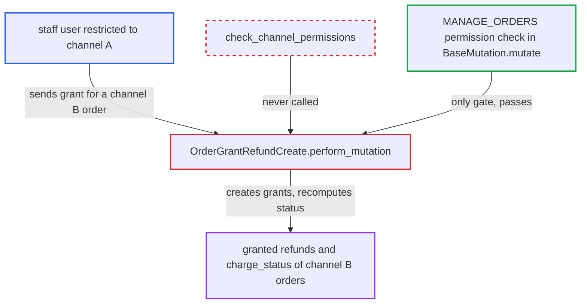

# orderGrantRefundCreate skips staff channel-restriction check

| Field | Value |
|---|---|
| ID | `find_01HYHneAESqNEjsRBqApGau4` |
| Severity | **Low** |
| Status | open |
| CWE | CWE-862 — Missing Authorization |
| Created | 2026-10-27T21:15:25.688869Z |
| Claude Security | https://claude.ai/security/findings/find_01HYHneAESqNEjsRBqApGau4 |

## Description

A staff user limited to one channel can create refund grants on orders of channels they are excluded from. This also recomputes those orders' `charge_status`. The attacker needs `MANAGE_ORDERS` in a channel-restricted group and the ids of a foreign order and one of its transactions. The cause is that `OrderGrantRefundCreate.perform_mutation` never calls `check_channel_permissions`.

1. **restricted staff user** sends `orderGrantRefundCreate` for an order in another channel. The user has `MANAGE_ORDERS` in a group restricted to channel A and targets an order in channel B, passing the order id and a `transactionId` with `amount` or `lines`. ([`saleor/graphql/core/mutations.py:584-599`](https://github.com/cx-benchmark/saleor/blob/c982006cc04c77a97def93218dedac8d715eb041/saleor/graphql/core/mutations.py#L584-L599))
2. **the mutation `OrderGrantRefundCreate.perform_mutation`** loads the order by its global id. It calls `get_node_or_error`, which goes to `get_node`, and that applies no channel filter, so the channel-B order is returned. ([`saleor/graphql/core/types/model.py:63-81`](https://github.com/cx-benchmark/saleor/blob/c982006cc04c77a97def93218dedac8d715eb041/saleor/graphql/core/types/model.py#L63-L81))
3. **the mutation `OrderGrantRefundCreate.perform_mutation`** skips the channel check and stores the grant. It never calls `check_channel_permissions`, so it runs `clean_input`, creates the granted refund with `order.granted_refunds.create(...)` and bulk-creates the `OrderGrantedRefund` lines. ([`saleor/graphql/order/mutations/order_grant_refund_create.py:293-325`](https://github.com/cx-benchmark/saleor/blob/c982006cc04c77a97def93218dedac8d715eb041/saleor/graphql/order/mutations/order_grant_refund_create.py#L293-L325))
4. **the mutation `OrderGrantRefundCreate.perform_mutation`** recomputes the order's charge data. `update_order_charge_data(order)` updates `charge_status` on the channel-B order from the new grant. ([`saleor/graphql/order/mutations/order_grant_refund_create.py:293-325`](https://github.com/cx-benchmark/saleor/blob/c982006cc04c77a97def93218dedac8d715eb041/saleor/graphql/order/mutations/order_grant_refund_create.py#L293-L325))

## Assessment

The attacker is an authenticated staff user with `MANAGE_ORDERS` in a permission group flagged `restricted_access_to_channels` to channel A. They need the UUID-based global id of a channel-B order and of one of its transactions. They can get these, for example, from an order they placed there as a customer, or from `order(id:){transactions{id}}`. They send `orderGrantRefundCreate(id, input:{transactionId, amount|lines})` to `/graphql/`. No GraphQL middleware adds a channel check. The sibling `orderGrantRefundUpdate` has the same omission, but the report files it separately.

Impact: The attacker can write `OrderGrantedRefund` records on orders of channels they are excluded from. The amount is capped at the linked transaction's charged value, and the records can carry lines, a shipping flag and a reason. The order's `charge_status` is recomputed from them. They cannot execute the grant, because `transactionRequestRefundForGrantedRefund` checks the channel, so no money moves directly. Channel-B staff with `HANDLE_PAYMENTS` could later execute the grant. There is no new data disclosure and no availability impact.

## Recommendation

`OrderGrantRefundCreate.perform_mutation` authorises only with the `MANAGE_ORDERS` permission. It never checks that the order's channel is among the requesting staff user's accessible channels, unlike the other order mutations.

Fix criteria: A staff user whose permission group is restricted to channels not containing the order's channel gets a `PermissionDenied` error from `orderGrantRefundCreate`. No `OrderGrantedRefund` row is created and `charge_status` does not change. A test mirroring `test_order_note_add_by_user_no_channel_access` confirms this: the permission group is limited to the USD channel and the order is moved to the PLN channel. It asserts `assert_no_permission` and an unchanged `order.granted_refunds` count. Apps keep full-channel access.

## Evidence

**https://github.com/cx-benchmark/saleor**

- [`saleor/graphql/order/mutations/order_grant_refund_create.py:293-325`](https://github.com/cx-benchmark/saleor/blob/c982006cc04c77a97def93218dedac8d715eb041/saleor/graphql/order/mutations/order_grant_refund_create.py#L293-L325)
- [`saleor/graphql/core/mutations.py:584-599`](https://github.com/cx-benchmark/saleor/blob/c982006cc04c77a97def93218dedac8d715eb041/saleor/graphql/core/mutations.py#L584-L599)
- [`saleor/graphql/core/types/model.py:63-81`](https://github.com/cx-benchmark/saleor/blob/c982006cc04c77a97def93218dedac8d715eb041/saleor/graphql/core/types/model.py#L63-L81)
- [`saleor/graphql/order/mutations/order_note_add.py:52-54`](https://github.com/cx-benchmark/saleor/blob/c982006cc04c77a97def93218dedac8d715eb041/saleor/graphql/order/mutations/order_note_add.py#L52-L54)
- [`saleor/graphql/payment/mutations/transaction/transaction_request_refund_for_granted_refund.py:155-158`](https://github.com/cx-benchmark/saleor/blob/c982006cc04c77a97def93218dedac8d715eb041/saleor/graphql/payment/mutations/transaction/transaction_request_refund_for_granted_refund.py#L155-L158)

