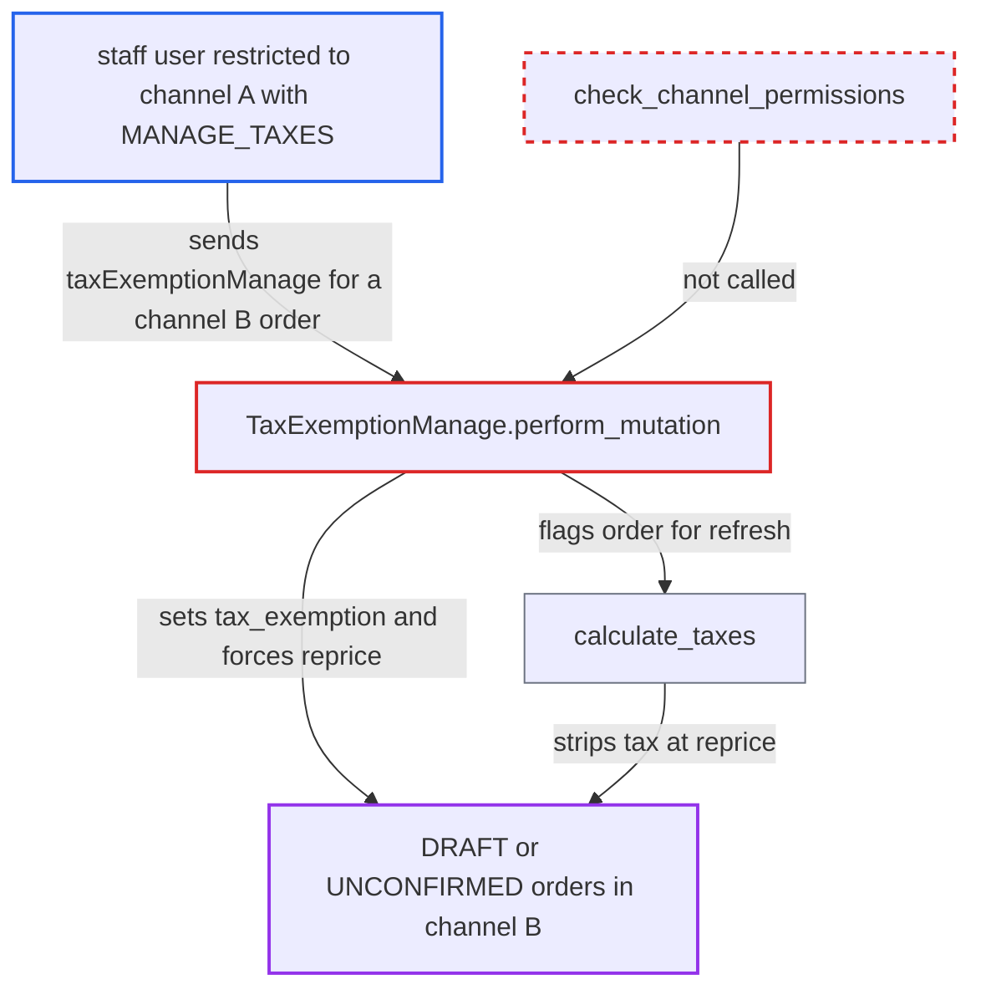

# taxExemptionManage lets channel-restricted staff change tax on other channels' orders

| Field | Value |
|---|---|
| ID | `find_013jjmTCXbQmGGK5fjPEqiuY` |
| Severity | **Low** |
| Status | open |
| CWE | CWE-862 — Missing authorization |
| Created | 2026-10-27T21:17:54.088252Z |
| Claude Security | https://claude.ai/security/findings/find_013jjmTCXbQmGGK5fjPEqiuY |

## Description

A staff user restricted to one channel can switch tax exemption on or off for draft or unconfirmed orders in other channels. That strips tax from the order's totals or adds it back. The attacker needs the `MANAGE_TAXES` permission and the ID of a foreign-channel order. The cause is that `TaxExemptionManage.perform_mutation` never checks the order's channel.

1. **restricted staff user** obtains the global ID of a DRAFT or UNCONFIRMED order in channel B. The user holds `MANAGE_TAXES` in a group restricted to channel A, and the order ID is an unguessable UUID, for example one supplied by a colluding customer who owns the order.
2. **restricted staff user** sends `taxExemptionManage` with `taxExemption: true` for that order to `/graphql/`. The only authorization is `CheckoutPermissions.MANAGE_TAXES`, which is checked without regard to channel. ([`saleor/graphql/tax/mutations/tax_exemption_manage.py:54`](https://github.com/cx-benchmark/saleor/blob/c982006cc04c77a97def93218dedac8d715eb041/saleor/graphql/tax/mutations/tax_exemption_manage.py#L54))
3. **the mutation `TaxExemptionManage.perform_mutation`** loads the order by primary key. `get_node` applies no channel filter, so an order from any channel resolves. ([`saleor/graphql/core/types/model.py:63-81`](https://github.com/cx-benchmark/saleor/blob/c982006cc04c77a97def93218dedac8d715eb041/saleor/graphql/core/types/model.py#L63-L81))
4. **the mutation `TaxExemptionManage.perform_mutation`** sets `tax_exemption` and `should_refresh_prices = True` and saves. No `check_channel_permissions` call is made, although every other order mutation such as `orderDiscountAdd` makes one. ([`saleor/graphql/tax/mutations/tax_exemption_manage.py:93-116`](https://github.com/cx-benchmark/saleor/blob/c982006cc04c77a97def93218dedac8d715eb041/saleor/graphql/tax/mutations/tax_exemption_manage.py#L93-L116))
5. **the function `calculate_taxes`** removes tax from the order's lines, shipping and totals at the next price refresh. It computes `should_charge_tax = charge_taxes and not order.tax_exemption`, so an exempt order loses its tax. ([`saleor/order/calculations.py:318-332`](https://github.com/cx-benchmark/saleor/blob/c982006cc04c77a97def93218dedac8d715eb041/saleor/order/calculations.py#L318-L332))

## Assessment

The attacker is a staff user with `MANAGE_TAXES` in a permission group whose `restricted_access_to_channels` limits it to channel A. They must know the global ID of a DRAFT or UNCONFIRMED order in channel B. That ID is an unguessable UUID, so they need to get it from outside their channels, for example from a colluding customer who owns the order. No victim action is needed. Only the Order branch of the mutation is affected, because no checkout code applies channel restrictions. The same user can change channel B's `TaxConfiguration` through `taxConfigurationUpdate`, which has no channel scope. That does not reprice existing orders whose `should_refresh_prices` is false, such as orders created from checkout.

Impact: The attacker changes the tax treatment and recalculated totals of a chosen draft or unconfirmed order in a channel they may not manage. Setting the flag back to false re-adds the tax. The effect is limited to the tax component and to orders in editable statuses. The report finds no confidentiality gain beyond the `order(id:)` query, which is also unscoped, and no availability impact.

## Recommendation

`TaxExemptionManage.perform_mutation` changes an `Order` it resolved by primary key without checking that the staff user can access the order's channel. Every other order mutation applies this channel-restriction rule.

Fix criteria: When the resolved object is an Order, the mutation applies the same channel-access check as other order mutations before it saves anything. Apps keep all-channel access. A test uses a staff user with `MANAGE_TAXES` in a group restricted to channel A. Calling `taxExemptionManage` on a channel B draft or unconfirmed order returns a permission error and leaves `tax_exemption` and `should_refresh_prices` unchanged. The same call on a channel A order still succeeds.

## Evidence

**https://github.com/cx-benchmark/saleor**

- [`saleor/graphql/tax/mutations/tax_exemption_manage.py:93-116`](https://github.com/cx-benchmark/saleor/blob/c982006cc04c77a97def93218dedac8d715eb041/saleor/graphql/tax/mutations/tax_exemption_manage.py#L93-L116)
- [`saleor/graphql/tax/mutations/tax_exemption_manage.py:54`](https://github.com/cx-benchmark/saleor/blob/c982006cc04c77a97def93218dedac8d715eb041/saleor/graphql/tax/mutations/tax_exemption_manage.py#L54)
- [`saleor/graphql/core/mutations.py:585-598`](https://github.com/cx-benchmark/saleor/blob/c982006cc04c77a97def93218dedac8d715eb041/saleor/graphql/core/mutations.py#L585-L598)
- [`saleor/graphql/order/mutations/order_discount_add.py:66-68`](https://github.com/cx-benchmark/saleor/blob/c982006cc04c77a97def93218dedac8d715eb041/saleor/graphql/order/mutations/order_discount_add.py#L66-L68)
- [`saleor/graphql/core/types/model.py:63-81`](https://github.com/cx-benchmark/saleor/blob/c982006cc04c77a97def93218dedac8d715eb041/saleor/graphql/core/types/model.py#L63-L81)
- [`saleor/order/calculations.py:318-332`](https://github.com/cx-benchmark/saleor/blob/c982006cc04c77a97def93218dedac8d715eb041/saleor/order/calculations.py#L318-L332)
- [`saleor/checkout/complete_checkout.py:819`](https://github.com/cx-benchmark/saleor/blob/c982006cc04c77a97def93218dedac8d715eb041/saleor/checkout/complete_checkout.py#L819)

