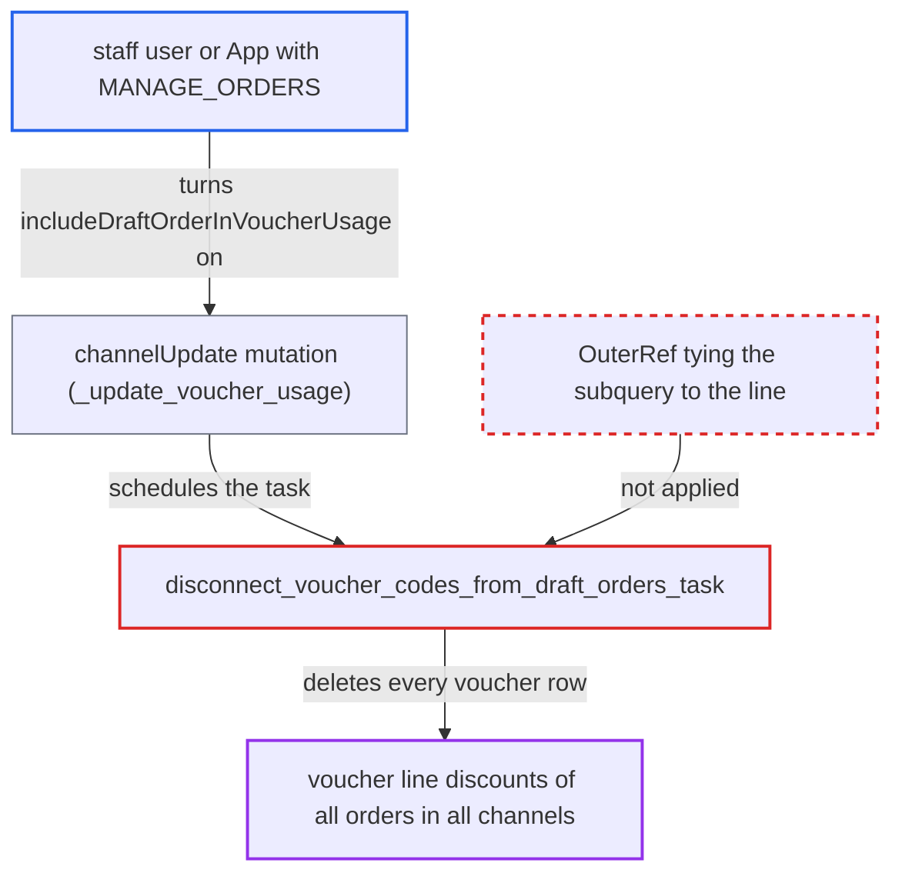

# Uncorrelated Exists in voucher-disconnect task deletes voucher line discounts of all orders

| Field | Value |
|---|---|
| ID | `find_01Xfr8vdgHbnLPgWWGNbEBH2` |
| Severity | **Low** |
| Status | open |
| CWE | CWE-1025 — Incorrect comparison |
| Created | 2026-10-27T21:13:26.036757Z |
| Claude Security | https://claude.ai/security/findings/find_01Xfr8vdgHbnLPgWWGNbEBH2 |

## Description

A staff user or App with `MANAGE_ORDERS`, even one limited to a single channel, can permanently delete the voucher line discount records of every order in every channel. That includes completed orders and channels the actor cannot access. The cause is the `OrderLineDiscount` cleanup in `disconnect_voucher_codes_from_draft_orders_task`. Its `Exists` subquery is not tied to the discount's line, so it matches every row.

1. **attacker with `MANAGE_ORDERS`** creates a draft order with a voucher and one line. The attacker calls `draftOrderCreate` with a `voucherCode` for a voucher listed in a channel they can use, so the channel has a targeted draft order that has a line.
2. **attacker** switches `includeDraftOrderInVoucherUsage` to true with `channelUpdate`. `check_permissions` accepts an input holding only `orderSettings` with just `MANAGE_ORDERS`, and the setting is first set to false if it is not already. ([`saleor/graphql/channel/mutations/channel_update.py:186-218`](https://github.com/cx-benchmark/saleor/blob/c982006cc04c77a97def93218dedac8d715eb041/saleor/graphql/channel/mutations/channel_update.py#L186-L218))
3. **`_update_voucher_usage`** schedules the voucher-disconnect task. It does this when the setting goes from False to True, using the previous value taken from `clean_input_order_settings`. ([`saleor/graphql/channel/mutations/channel_update.py:296-309`](https://github.com/cx-benchmark/saleor/blob/c982006cc04c77a97def93218dedac8d715eb041/saleor/graphql/channel/mutations/channel_update.py#L296-L309))
4. **`disconnect_voucher_codes_from_draft_orders`** builds the list of draft orders of that one channel that have a voucher code. This shows the intended scope is one channel and its draft orders. ([`saleor/discount/tasks.py:293-301`](https://github.com/cx-benchmark/saleor/blob/c982006cc04c77a97def93218dedac8d715eb041/saleor/discount/tasks.py#L293-L301))
5. **the task `disconnect_voucher_codes_from_draft_orders_task`** deletes `OrderLineDiscount` rows with an `Exists(OrderLine.objects.filter(order_id__in=order_ids))` filter. The subquery has no `OuterRef` to `line_id`, so it is true for every row once any targeted draft order has a line, and the chained `type=DiscountType.VOUCHER` filter then deletes every voucher line discount. It also uses the full `order_ids` list rather than the batch `ids`, so each batch repeats the deletion. ([`saleor/discount/tasks.py:320-322`](https://github.com/cx-benchmark/saleor/blob/c982006cc04c77a97def93218dedac8d715eb041/saleor/discount/tasks.py#L320-L322))
6. **the Celery worker** permanently removes the line-level voucher discounts of completed orders. Checkout completion stores these discounts only as `OrderLineDiscount` rows, so for non-editable orders they are lost. ([`saleor/checkout/complete_checkout.py:497-537`](https://github.com/cx-benchmark/saleor/blob/c982006cc04c77a97def93218dedac8d715eb041/saleor/checkout/complete_checkout.py#L497-L537))

## Assessment

The attacker is a staff user or App with `MANAGE_ORDERS`, possibly restricted to one channel. They need a voucher listed in a channel they can use. They create a draft order with `voucherCode` and one line. Then they call `channelUpdate` with `orderSettings` set to `includeDraftOrderInVoucherUsage: true`, setting it to false first if needed. No victim action is needed. The Celery worker runs the delete, and the attacker can repeat the attack.

Impact: All voucher line discount records of every order in every channel are irreversibly deleted, including completed orders and channels the actor cannot access. The API and the legacy `Order.discounts` view stop showing which voucher was applied, and draft and unconfirmed orders in other channels lose them while `voucher_code` stays set. Stored amounts on `OrderLine` and `Order` do not change, and editable orders get their records back at the next recalculation. The report names no disclosure and no denial of service.

## Recommendation

The bulk delete of `OrderLineDiscount` rows in `disconnect_voucher_codes_from_draft_orders_task` is not tied to the lines of the orders being processed. A per-channel housekeeping task therefore deletes discount records of unrelated orders and channels.

Fix criteria: Only voucher line discounts whose line belongs to an order in the current batch are deleted. To verify, give a completed order in channel B a `SPECIFIC_PRODUCT` voucher line discount. Then toggle `includeDraftOrderInVoucherUsage` from false to true on channel A, which has a draft order with a voucher and a line. Channel B's `OrderLineDiscount` rows must remain. Only those of channel A's batched draft orders may be removed.

## Evidence

**https://github.com/cx-benchmark/saleor**

- [`saleor/discount/tasks.py:320-322`](https://github.com/cx-benchmark/saleor/blob/c982006cc04c77a97def93218dedac8d715eb041/saleor/discount/tasks.py#L320-L322)
- [`saleor/discount/tasks.py:293-301`](https://github.com/cx-benchmark/saleor/blob/c982006cc04c77a97def93218dedac8d715eb041/saleor/discount/tasks.py#L293-L301)
- [`saleor/graphql/channel/mutations/channel_update.py:296-309`](https://github.com/cx-benchmark/saleor/blob/c982006cc04c77a97def93218dedac8d715eb041/saleor/graphql/channel/mutations/channel_update.py#L296-L309)
- [`saleor/graphql/channel/mutations/channel_update.py:186-218`](https://github.com/cx-benchmark/saleor/blob/c982006cc04c77a97def93218dedac8d715eb041/saleor/graphql/channel/mutations/channel_update.py#L186-L218)
- [`saleor/graphql/order/mutations/order_discount_common.py:38-47`](https://github.com/cx-benchmark/saleor/blob/c982006cc04c77a97def93218dedac8d715eb041/saleor/graphql/order/mutations/order_discount_common.py#L38-L47)
- [`saleor/checkout/complete_checkout.py:497-537`](https://github.com/cx-benchmark/saleor/blob/c982006cc04c77a97def93218dedac8d715eb041/saleor/checkout/complete_checkout.py#L497-L537)

