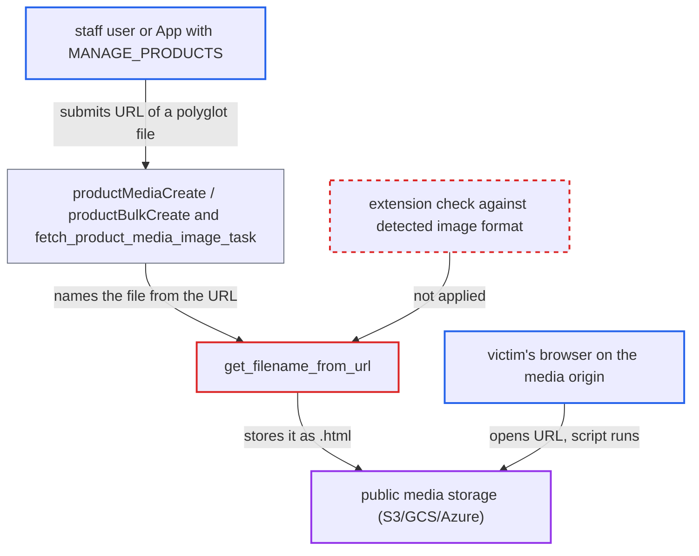

# URL-fetched product media keeps attacker-chosen extension, storing HTML polyglots in public media

| Field | Value |
|---|---|
| ID | `find_01DM8hvErs7BYnWCvK7ew9VE` |
| Severity | **Low** |
| Status | open |
| CWE | CWE-434 — Unrestricted file upload |
| Created | 2026-10-27T21:13:25.959906Z |
| Claude Security | https://claude.ai/security/findings/find_01DM8hvErs7BYnWCvK7ew9VE |

## Description

A staff user or App with `MANAGE_PRODUCTS` can put an HTML page with attacker script into the shop's public media storage. A victim who opens the media URL runs that script on the media domain. The impact is limited, and it needs media served by type from the file name with no forced download. The cause is `get_filename_from_url()`, which keeps the extension from the attacker's URL.

1. **attacker with `MANAGE_PRODUCTS`** hosts a GIF/HTML polyglot at a URL ending in `.html`. The server answers with `Content-Type: image/gif`, and the body is a valid image that also carries a `<script>` tag, for example in a comment or after the image trailer.
2. **attacker** calls `productMediaCreate` with `mediaUrl` set to that URL. `probe_media_url` checks only the response `Content-Type`, then the fetch task is scheduled. `productBulkCreate` schedules the same task. ([`saleor/graphql/product/mutations/product/product_media_create.py:107-121`](https://github.com/cx-benchmark/saleor/blob/c982006cc04c77a97def93218dedac8d715eb041/saleor/graphql/product/mutations/product/product_media_create.py#L107-L121))
3. **the task `fetch_product_media_image_task`** downloads the file and runs the byte checks. It requires only an `image/*` `Content-Type` header from the attacker's server, so the polyglot is accepted. ([`saleor/product/tasks.py:404-443`](https://github.com/cx-benchmark/saleor/blob/c982006cc04c77a97def93218dedac8d715eb041/saleor/product/tasks.py#L404-L443))
4. **the checks in `create_image()`** accept the polyglot as an image. `validate_image_mime_type()` runs libmagic on the first 1024 bytes and `validate_image_exif()` only needs Pillow to open the header. Neither looks at the extension. ([`saleor/product/utils/tasks_utils.py:29-62`](https://github.com/cx-benchmark/saleor/blob/c982006cc04c77a97def93218dedac8d715eb041/saleor/product/utils/tasks_utils.py#L29-L62))
5. **`get_filename_from_url()`** builds the stored name with the extension from the URL path. It copies the extension as given, so `https://evil.example/x.html` becomes `x_<hash>.html`. It guesses an extension from the MIME type only when the URL has none. ([`saleor/thumbnail/utils.py:304-313`](https://github.com/cx-benchmark/saleor/blob/c982006cc04c77a97def93218dedac8d715eb041/saleor/thumbnail/utils.py#L304-L313))
6. **the storage backend in `saleor/core/storages.py`** saves the file in public media and serves it as `text/html`. The saved file has no content type of its own. The S3/GCS/Azure backends set it from the name, and the report assumes django-storages 1.14.6 does this. The file is sent inline with no `Content-Disposition`. ([`saleor/settings.py:582-587`](https://github.com/cx-benchmark/saleor/blob/c982006cc04c77a97def93218dedac8d715eb041/saleor/settings.py#L582-L587))
7. **victim** opens the media URL exposed by `ProductMedia.url(size: 0)` or the `/image/<id>/` redirect. The browser renders the file as HTML and the script runs on the media origin.

## Assessment

The attacker is a staff user or App holding `MANAGE_PRODUCTS`. They need a web server they control that returns an `image/*` `Content-Type` and a GIF or PNG that also contains HTML script. They can use `productMediaCreate` with `mediaUrl`, or `productBulkCreate` media, since both schedule the same fetch task. The attack works only if media is served with a type taken from the file name and without a forced download, as the shipped S3/GCS/Azure backends do. Saleor itself does not serve media in production. Deployments whose CDN or proxy forces `Content-Disposition: attachment`, as the dev view `serve_media_view` does, do not run the file. A victim must open the media URL.

Impact: The attacker keeps HTML and JavaScript on the shop's media domain, linked from the catalogue. It can be used for phishing or for script under the merchant's media domain. The report finds no way to reach Saleor credentials from that origin. The refresh cookie is httpOnly and needs a CSRF token, and access tokens travel in headers. The impact is a limited loss of confidentiality and integrity.

## Recommendation

`get_filename_from_url()` and `create_image()` take the stored file's extension from the attacker-supplied URL path, not from the validated image format. A non-image extension such as `.html` reaches public storage and sets the served `Content-Type`.

Fix criteria: Every remotely fetched product image is stored with an extension derived from, or checked against, the format detected from its bytes, using the same allow-list as `_validate_image_format`. URLs with no extension, or a non-matching or non-image extension, are renamed or rejected. To verify, fetch a `Content-Type: image/gif` polyglot from a URL ending in `.html`. Confirm the stored `ProductMedia.image.name` ends in `.gif`, or that the fetch is rejected.

## Evidence

**https://github.com/cx-benchmark/saleor**

- [`saleor/thumbnail/utils.py:304-313`](https://github.com/cx-benchmark/saleor/blob/c982006cc04c77a97def93218dedac8d715eb041/saleor/thumbnail/utils.py#L304-L313)
- [`saleor/product/utils/tasks_utils.py:29-62`](https://github.com/cx-benchmark/saleor/blob/c982006cc04c77a97def93218dedac8d715eb041/saleor/product/utils/tasks_utils.py#L29-L62)
- [`saleor/product/tasks.py:404-443`](https://github.com/cx-benchmark/saleor/blob/c982006cc04c77a97def93218dedac8d715eb041/saleor/product/tasks.py#L404-L443)
- [`saleor/graphql/product/mutations/product/product_media_create.py:107-121`](https://github.com/cx-benchmark/saleor/blob/c982006cc04c77a97def93218dedac8d715eb041/saleor/graphql/product/mutations/product/product_media_create.py#L107-L121)
- [`saleor/graphql/core/validators/file.py:174-196`](https://github.com/cx-benchmark/saleor/blob/c982006cc04c77a97def93218dedac8d715eb041/saleor/graphql/core/validators/file.py#L174-L196)
- [`saleor/settings.py:582-587`](https://github.com/cx-benchmark/saleor/blob/c982006cc04c77a97def93218dedac8d715eb041/saleor/settings.py#L582-L587)

