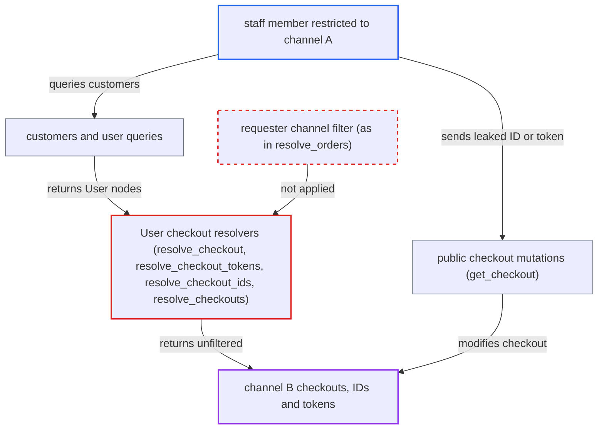

# User checkout fields ignore staff channel restrictions, exposing other channels' checkouts

| Field | Value |
|---|---|
| ID | `find_0171oFoZZSxgVkW5qt3udF32` |
| Severity | **Low** |
| Status | open |
| CWE | CWE-863 — Incorrect authorization |
| Created | 2026-10-27T22:13:21.689787Z |
| Claude Security | https://claude.ai/security/findings/find_0171oFoZZSxgVkW5qt3udF32 |

## Description

Staff whose permission groups are restricted to one sales channel can read other channels' in-progress checkouts of registered customers. The checkout ID and token they get back also let them change those checkouts. This needs a staff account with `MANAGE_ORDERS` or `MANAGE_USERS` in a group with `restricted_access_to_channels` turned on (off by default). The four checkout fields on the `User` type never check the requester's accessible channels.

1. **channel-restricted staff member** queries `customers` or `user(...)` over `/graphql/`. Both are open to `MANAGE_ORDERS` or `MANAGE_USERS` and are not scoped to channels, so they return `User` nodes for customers in all channels. ([`saleor/graphql/account/schema.py:169-184`](https://github.com/cx-benchmark/saleor/blob/c982006cc04c77a97def93218dedac8d715eb041/saleor/graphql/account/schema.py#L169-L184))
2. **staff member** asks for `checkout`, `checkoutTokens`, `checkoutIds` or `checkouts` on each `User`, optionally with a `channel` slug such as `channel-b`. The caller-supplied `channel` slug is passed on without any check against the channels the requester may access. ([`saleor/graphql/account/types.py:699-743`](https://github.com/cx-benchmark/saleor/blob/c982006cc04c77a97def93218dedac8d715eb041/saleor/graphql/account/types.py#L699-L743))
3. **the resolvers `resolve_checkout` and `resolve_checkout_tokens`** return the user's latest checkout or its raw token for any active channel. They do not look up the requester's accessible channels, unlike `resolve_orders` on the same type. ([`saleor/graphql/account/types.py:659-696`](https://github.com/cx-benchmark/saleor/blob/c982006cc04c77a97def93218dedac8d715eb041/saleor/graphql/account/types.py#L659-L696))
4. **the loaders `CheckoutByUserLoader` and `CheckoutByUserAndChannelLoader`** load the user's checkouts filtered only by user and active channel. They filter on `user_id` and `channel__is_active`, and they have no knowledge of the requester, so nothing below the resolver applies the channel restriction. ([`saleor/graphql/checkout/dataloaders/models.py:19-50`](https://github.com/cx-benchmark/saleor/blob/c982006cc04c77a97def93218dedac8d715eb041/saleor/graphql/checkout/dataloaders/models.py#L19-L50))
5. **staff member** reads the other channels' checkouts and takes their IDs and tokens. The fields returned include `email`, `shippingAddress`, `billingAddress`, `lines`, totals, `voucherCode`, `customerNote` and public metadata, and none of them has a permission gate.
6. **staff member** calls public checkout mutations such as `checkoutShippingAddressUpdate`, `checkoutLinesUpdate` or `checkoutEmailUpdate` with a leaked ID. `get_checkout` accepts a checkout by `id` or `token` alone, with no owner or channel check, so the leaked value works as a bearer credential. ([`saleor/graphql/checkout/mutations/utils.py:261-300`](https://github.com/cx-benchmark/saleor/blob/c982006cc04c77a97def93218dedac8d715eb041/saleor/graphql/checkout/mutations/utils.py#L261-L300))

## Assessment

The attacker is an authenticated staff member whose permission groups grant `MANAGE_ORDERS` or `MANAGE_USERS` and are all restricted to one channel (channel A). The owner must have set up such a channel-restricted group, which is not the default. The attacker sends a GraphQL query over the internet-facing `/graphql/`, either through `customers` or through the single-object `user(id/email/externalReference)`. They may add a `channel` slug for the channel they want. No victim action is needed.

Impact: The attacker can read the in-progress checkouts of registered customers in channels they are excluded from. This covers cart lines, addresses, email, voucher codes, notes and public metadata. With the leaked IDs and tokens they can change lines, addresses, email, promo codes and the delivery method of those checkouts. The damage is limited: customer profiles are already visible to them, private metadata, the voucher object and transactions stay gated, and the changes only touch in-progress carts the customer can still review.

## Recommendation

`User.resolve_checkout`, `resolve_checkout_tokens`, `resolve_checkout_ids` and `resolve_checkouts` in `saleor/graphql/account/types.py` return the target user's checkouts in every active channel. They do not consult the requester's accessible channels, unlike `resolve_orders` and `resolve_transactions`.

Fix criteria: When the requester is a staff `User` other than the `User` being resolved, all four checkout fields return only checkouts whose `channel_id` is among the requester's accessible channels. This holds when a `channel` slug is passed too. Owner and app requesters keep current behaviour. Check it like this: a staff user in a group restricted to channel A queries `customers { edges { node { checkout { id } checkoutTokens checkoutIds checkouts(first: 10) { edges { node { id } } } } } }` for a customer with a channel-B checkout and receives none of it.

## Evidence

**https://github.com/cx-benchmark/saleor**

- [`saleor/graphql/account/types.py:699-743`](https://github.com/cx-benchmark/saleor/blob/c982006cc04c77a97def93218dedac8d715eb041/saleor/graphql/account/types.py#L699-L743)
- [`saleor/graphql/account/types.py:659-696`](https://github.com/cx-benchmark/saleor/blob/c982006cc04c77a97def93218dedac8d715eb041/saleor/graphql/account/types.py#L659-L696)
- [`saleor/graphql/account/types.py:809-897`](https://github.com/cx-benchmark/saleor/blob/c982006cc04c77a97def93218dedac8d715eb041/saleor/graphql/account/types.py#L809-L897)
- [`saleor/graphql/checkout/dataloaders/models.py:19-50`](https://github.com/cx-benchmark/saleor/blob/c982006cc04c77a97def93218dedac8d715eb041/saleor/graphql/checkout/dataloaders/models.py#L19-L50)
- [`saleor/graphql/account/schema.py:169-184`](https://github.com/cx-benchmark/saleor/blob/c982006cc04c77a97def93218dedac8d715eb041/saleor/graphql/account/schema.py#L169-L184)
- [`saleor/graphql/payment/resolvers.py:47-73`](https://github.com/cx-benchmark/saleor/blob/c982006cc04c77a97def93218dedac8d715eb041/saleor/graphql/payment/resolvers.py#L47-L73)
- [`saleor/graphql/checkout/mutations/utils.py:261-300`](https://github.com/cx-benchmark/saleor/blob/c982006cc04c77a97def93218dedac8d715eb041/saleor/graphql/checkout/mutations/utils.py#L261-L300)

