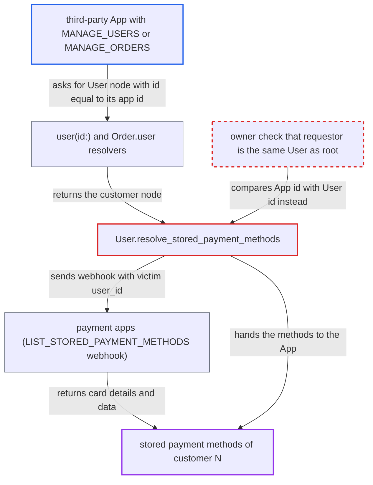

# User.storedPaymentMethods owner check compares App id with User id

| Field | Value |
|---|---|
| ID | `find_011WBjUzUexptWjhPHkjQsBv` |
| Severity | **Low** |
| Status | open |
| CWE | CWE-863 — Incorrect authorization |
| Created | 2026-10-27T21:42:14.030508Z |
| Claude Security | https://claude.ai/security/findings/find_011WBjUzUexptWjhPHkjQsBv |

## Description

A third-party App can read the stored payment methods of one customer, which the API keeps for that customer alone. Even staff with `MANAGE_USERS` get an empty list. The App needs `MANAGE_USERS` or `MANAGE_ORDERS`, or a permission that opens `Order.user`, and its own id must equal the customer's id. The owner check in `User.resolve_stored_payment_methods` compares an `App` id with a `User` id.

1. **attacker App** reads its own id N through `app { id }`. The App's id is an integer from its own sequence, separate from the `User` sequence, so it can equal a customer's id.
2. **attacker App** queries the `User` node whose id is N. `user(id:)` returns customer nodes to apps with `MANAGE_USERS` or `MANAGE_ORDERS`, and `Order.user` does the same for apps with `MANAGE_USERS`, `MANAGE_ORDERS`, `HANDLE_PAYMENTS` or `HANDLE_TAXES`. ([`saleor/graphql/account/resolvers.py:76-110`](https://github.com/cx-benchmark/saleor/blob/c982006cc04c77a97def93218dedac8d715eb041/saleor/graphql/account/resolvers.py#L76-L110))
3. **attacker App** asks for `storedPaymentMethods(channel:)` on that node. For an app-token request the `App` is the requestor, because `get_user_or_app_from_context` returns `context.app or context.user` and `request.user` is forced to None. ([`saleor/graphql/utils/__init__.py:204-207`](https://github.com/cx-benchmark/saleor/blob/c982006cc04c77a97def93218dedac8d715eb041/saleor/graphql/utils/__init__.py#L204-L207))
4. **the resolver `resolve_stored_payment_methods`** accepts the App as the owner. It returns `[]` only when `requestor.id != root.id`, so an `App` id equal to the `User` id passes. ([`saleor/graphql/account/types.py:974-998`](https://github.com/cx-benchmark/saleor/blob/c982006cc04c77a97def93218dedac8d715eb041/saleor/graphql/account/types.py#L974-L998))
5. **`list_stored_payment_methods` in the webhook plugin** asks every payment app for the victim's methods. It sends the `LIST_STORED_PAYMENT_METHODS` webhook with the victim's `user_id` and returns the stored methods to the caller. ([`saleor/plugins/webhook/plugin.py:2834-2880`](https://github.com/cx-benchmark/saleor/blob/c982006cc04c77a97def93218dedac8d715eb041/saleor/plugins/webhook/plugin.py#L2834-L2880))

## Assessment

The attacker is a third-party App with `MANAGE_USERS` or `MANAGE_ORDERS`, or with a permission that opens `Order.user` (`HANDLE_PAYMENTS` or `HANDLE_TAXES`). It reads its own id N, then asks for `storedPaymentMethods` on the `User` node with id N. Customer N must exist with stored methods, and a payment app must be installed. A `MANAGE_APPS` staff member can choose N by creating apps. No victim action is needed.

Impact: The App reads one customer's stored payment-method data: gateway `paymentMethodId`, card brand, first and last digits, expiry, name, supported flows and provider `data`. Each app id reaches only one customer. The report finds no way to change or charge the methods through this field.

## Recommendation

The owner check in `User.resolve_stored_payment_methods` compares raw primary keys across two identity types (`App` and `User`). An App whose integer id matches a customer's id passes a check meant only for the customer.

Fix criteria: `User.storedPaymentMethods` returns data only to an authenticated `User` that is the same instance as `root`. Any `App` requestor gets an empty list. Test with an app client whose pk equals an existing customer's pk: `user(id:){storedPaymentMethods(channel:)}` returns `[]`. No `LIST_STORED_PAYMENT_METHODS` webhook is sent.

## Evidence

**https://github.com/cx-benchmark/saleor**

- [`saleor/graphql/account/types.py:974-998`](https://github.com/cx-benchmark/saleor/blob/c982006cc04c77a97def93218dedac8d715eb041/saleor/graphql/account/types.py#L974-L998)
- [`saleor/graphql/utils/__init__.py:204-207`](https://github.com/cx-benchmark/saleor/blob/c982006cc04c77a97def93218dedac8d715eb041/saleor/graphql/utils/__init__.py#L204-L207)
- [`saleor/graphql/context.py:77-97`](https://github.com/cx-benchmark/saleor/blob/c982006cc04c77a97def93218dedac8d715eb041/saleor/graphql/context.py#L77-L97)
- [`saleor/graphql/account/resolvers.py:76-110`](https://github.com/cx-benchmark/saleor/blob/c982006cc04c77a97def93218dedac8d715eb041/saleor/graphql/account/resolvers.py#L76-L110)
- [`saleor/graphql/order/types.py:2668-2686`](https://github.com/cx-benchmark/saleor/blob/c982006cc04c77a97def93218dedac8d715eb041/saleor/graphql/order/types.py#L2668-L2686)
- [`saleor/plugins/webhook/plugin.py:2834-2880`](https://github.com/cx-benchmark/saleor/blob/c982006cc04c77a97def93218dedac8d715eb041/saleor/plugins/webhook/plugin.py#L2834-L2880)
- [`saleor/graphql/account/tests/queries/test_user.py:1323-1348`](https://github.com/cx-benchmark/saleor/blob/c982006cc04c77a97def93218dedac8d715eb041/saleor/graphql/account/tests/queries/test_user.py#L1323-L1348)
- [`saleor/graphql/account/types.py:930-943`](https://github.com/cx-benchmark/saleor/blob/c982006cc04c77a97def93218dedac8d715eb041/saleor/graphql/account/types.py#L930-L943)

